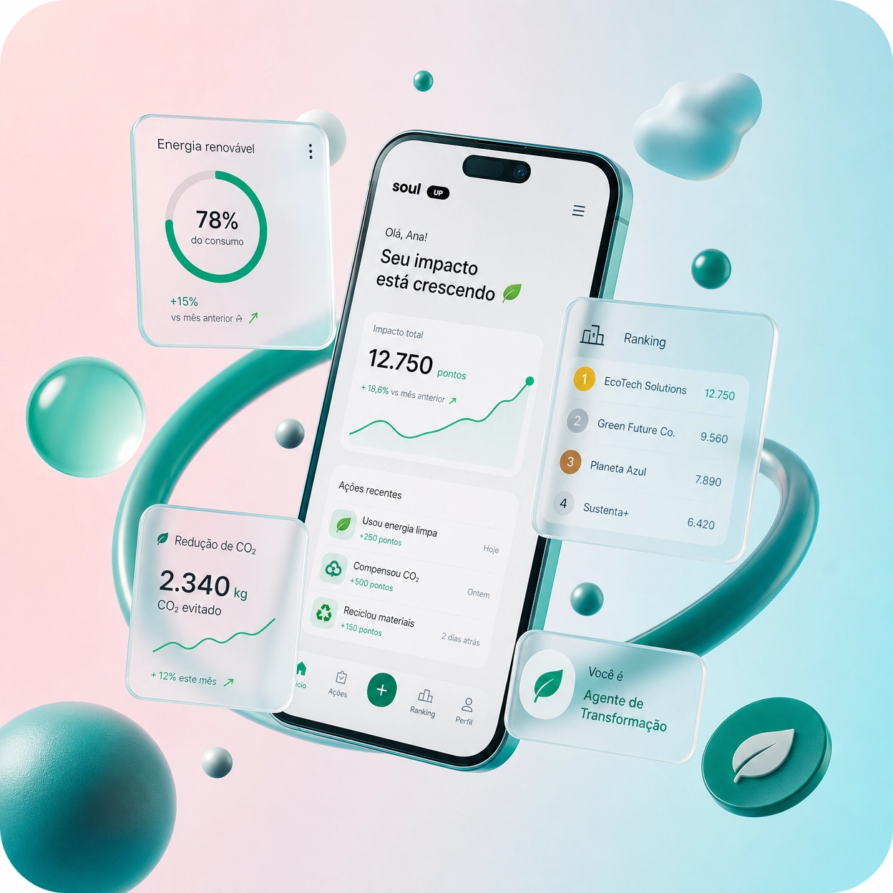
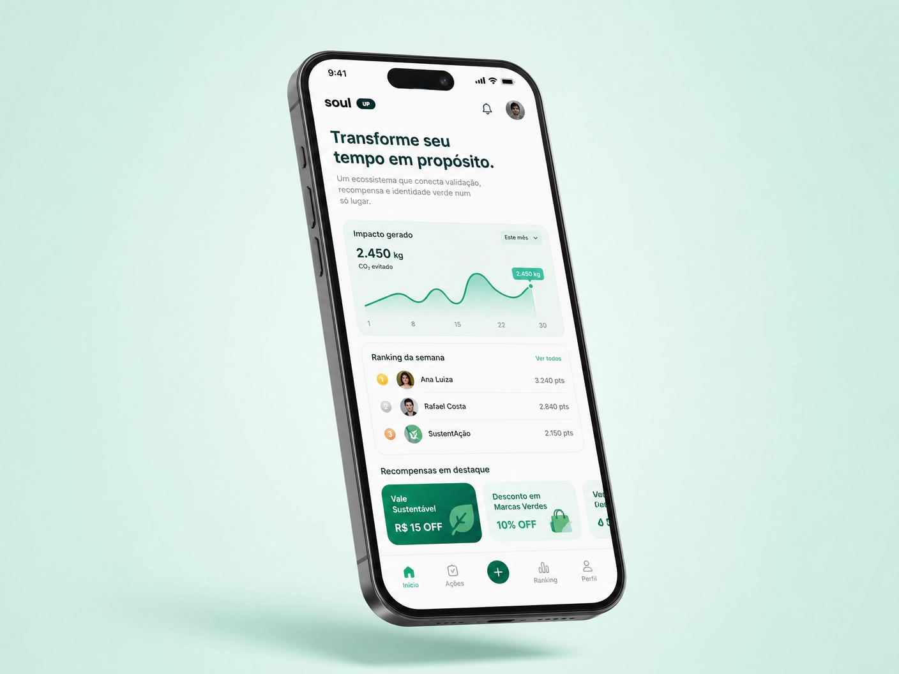

# SoulUp — Gamificação que recompensa atitudes sustentáveis

A *SoulUp* é uma plataforma de gamificação sustentável criada para transformar atitudes ecológicas individuais em impacto coletivo mensurável. A aplicação permite apresentar, validar e acompanhar ações sustentáveis por meio de pontos, rankings e recompensas, incentivando o engajamento com práticas responsáveis para o planeta.

O projeto foi desenvolvido pela equipe *NextCode* como parte dos desafios acadêmicos da FIAP e está disponível como uma aplicação web construída com *React, TypeScript, Vite e Tailwind CSS*.

## Acesso ao projeto

- *Aplicação publicada:* [challenge-soul-up-2-semestre.vercel.app](https://challenge-soul-up-2-semestre.vercel.app)

- *Repositório:* [github.com/Rochagx/Challenge_SoulUp_2Semestre](https://github.com/Rochagx/Challenge_SoulUp_2Semestre)

## Objetivos

A SoulUp foi concebida para responder a um problema de engajamento: muitas pessoas realizam ações sustentáveis, mas não conseguem visualizar o impacto acumulado dessas atitudes nem recebem incentivos para continuar. A plataforma propõe uma experiência digital na qual cada ação pode ser reconhecida, pontuada e integrada a uma visão coletiva de sustentabilidade.

A aplicação apresenta uma experiência que conecta *validação de ações, **pontuação, **ranking, **recompensas* e *identidade verde* em uma interface única.

## Funcionalidades

| Funcionalidade | Descrição |
| --- | --- |
| Página inicial | Apresenta o propósito da SoulUp, o problema da invisibilidade das ações sustentáveis e os principais indicadores da plataforma. |
| Plataforma | Explica o funcionamento do ecossistema de validação, recompensa e acompanhamento de impacto. |
| Validação de ação | Permite simular o envio de uma ação sustentável para validação. |
| Ranking | Exibe a lógica de classificação dos participantes de acordo com o impacto e a pontuação obtidos. |
| Recompensas | Apresenta incentivos relacionados ao engajamento sustentável, incluindo recompensas associadas ao consumo de energia. |
| Sobre o projeto | Reúne informações institucionais e conceituais sobre a solução. |
| Integrantes | Apresenta os membros da equipe responsável pelo desenvolvimento. |
| FAQ | Organiza respostas para dúvidas frequentes sobre a proposta da SoulUp. |
| Contato | Disponibiliza uma página para comunicação com a equipe. |

## Tecnologias utilizadas

| Tecnologia | Uso no projeto |
| --- | --- |
| [React](https://react.dev/) | Construção da interface por meio de componentes reutilizáveis. |
| [TypeScript](https://www.typescriptlang.org/) | Tipagem estática e maior segurança durante o desenvolvimento. |
| [Vite](https://vite.dev/) | Servidor de desenvolvimento e ferramenta de build da aplicação. |
| [React Router](https://reactrouter.com/) | Gerenciamento da navegação entre as páginas da aplicação. |
| [Tailwind CSS](https://tailwindcss.com/) | Estilização utilitária e definição do sistema visual da interface. |

## Pré-requisitos

Antes de executar o projeto, instale:

- [Node.js](https://nodejs.org/) em uma versão compatível com o Vite;

- npm, que acompanha a instalação do Node.js, ou outro gerenciador de pacotes compatível.

## Como executar localmente

1. Clone o repositório:

   bash
   git clone https://github.com/Rochagx/Challenge_SoulUp_2Semestre.git
   

1. Acesse a pasta do projeto:

   bash
   cd Challenge_SoulUp_2Semestre
   

1. Instale as dependências:

   bash
   npm install
   

1. Inicie o servidor de desenvolvimento:

   bash
   npm run dev
   

1. Abra no navegador o endereço exibido pelo Vite, normalmente http://localhost:5173.

## Scripts disponíveis

| Comando | Finalidade |
| --- | --- |
| npm run dev | Inicia o servidor local de desenvolvimento. |
| npm run build | Executa a verificação TypeScript e gera a versão otimizada para produção. |
| npm run preview | Inicia um servidor local para visualizar o build de produção. |
| npm run lint | Executa o ESLint para identificar problemas no código. |

## Estrutura do projeto


.
├── public/
│   └── logo.svg                  # Recurso público de logotipo
├── src/
│   ├── assets/                   # Imagens, logotipos e demais recursos visuais
│   │   ├── integrante-*.jpg/jpeg
│   │   ├── logo-nextcode.png
│   │   ├── logo.svg
│   │   ├── logo-white.svg
│   │   ├── premios-planeta-melhor.png
│   │   ├── soulup-gamificacao-sustentavel-dashboard.jpg
│   │   └── soulup-transforme-seu-tempo-em-proposito.jpg
│   ├── components/               # Componentes reutilizáveis da interface
│   │   ├── Button.tsx
│   │   ├── Card.tsx
│   │   ├── Container.tsx
│   │   ├── Footer.tsx
│   │   ├── Header.tsx
│   │   ├── Icon.tsx
│   │   ├── Layout.tsx
│   │   ├── Modal.tsx
│   │   └── SectionHeading.tsx
│   ├── hooks/
│   │   └── useDocumentMeta.ts    # Hook para atualização dos metadados da página
│   ├── pages/                    # Páginas acessíveis pela aplicação
│   │   ├── Contato.tsx
│   │   ├── Faq.tsx
│   │   ├── Home.tsx
│   │   ├── Integrantes.tsx
│   │   ├── Plataforma.tsx
│   │   ├── Ranking.tsx
│   │   ├── Sobre.tsx
│   │   └── Validar.tsx
│   ├── App.tsx                   # Configuração das rotas principais
│   ├── index.css                 # Estilos globais
│   └── main.tsx                  # Ponto de entrada da aplicação
├── index.html
├── package.json
├── postcss.config.js
├── tailwind.config.js
├── tsconfig.app.json
├── tsconfig.json
├── tsconfig.node.json
└── vite.config.ts


### Organização da aplicação

A aplicação utiliza o componente Layout como estrutura compartilhada entre as páginas. Os componentes de cabeçalho, rodapé, botões, cards, modais e títulos de seção ficam centralizados em src/components, favorecendo a reutilização e a consistência visual.

As páginas são organizadas em src/pages. A navegação entre elas é gerenciada pelo react-router-dom no arquivo src/App.tsx. Os estilos globais ficam em src/index.css, enquanto as cores, tipografia, espaçamentos, sombras e animações do sistema visual são configurados no tailwind.config.js.

## Rotas da aplicação

| Rota | Página |
| --- | --- |
| / | Página inicial |
| /sobre | Sobre o projeto |
| /integrantes | Integrantes da equipe |
| /faq | Perguntas frequentes |
| /contato | Contato |
| /plataforma | Apresentação da plataforma |
| /ranking | Ranking de participantes |
| /validar | Validação de ação sustentável |

## Identidade visual

O projeto utiliza uma identidade visual baseada em tons de verde, azul-petróleo, turquesa e verde-limão. O Tailwind CSS concentra as principais decisões de design, incluindo:

- cores semânticas para superfícies, bordas, textos, sucesso, alerta e erro;

- tipografia de destaque com *Poppins*;

- tipografia de corpo com *Inter*;

- bordas arredondadas para cards e elementos de interação;

- sombras suaves para criar hierarquia visual;

- animações de entrada para transições e componentes da interface.

## Imagens do projeto

### Dashboard da plataforma



A imagem representa a experiência de acompanhamento do impacto sustentável, com foco em ranking, gamificação e indicadores da plataforma.

### Visão conceitual da aplicação



A arte apresenta a proposta da SoulUp de transformar ações cotidianas em propósito, reconhecimento e impacto coletivo.

## Autores e créditos

O projeto foi desenvolvido pela equipe *NextCode, formada por estudantes da turma **1TDSPO* do curso de Análise e Desenvolvimento de Sistemas da FIAP.

| Nome | RM | Turma | LinkedIn | GitHub |
| --- | --- | --- | --- | --- |
| Guilherme dos Santos Rocha | 570005 | 1TDSPO | [Perfil profissional](https://www.linkedin.com/in/guilherme-rocha-tech/) | [Rochagx](https://github.com/Rochagx) |
| Giovanni Della Crucce Azevedo Santana | 572752 | 1TDSPO | [Perfil profissional](https://www.linkedin.com/in/giovanni-santana-7bb590249/) | [giovannidcas](https://github.com/giovannidcas) |
| César Anastácio dos Anjos Ledres | 573833 | 1TDSPO | [Perfil profissional](https://www.linkedin.com/in/c%C3%A9sar-ledres-679240318/) | [cesarledres](https://github.com/cesarledres) |
| Caio Gonçalves Feixas | 569956 | 1TDSPO | [Perfil profissional](https://www.linkedin.com/in/caio-gon%C3%A7alves-450008322/) | [Caiofeixas](https://github.com/Caiofeixas) |
| Théo Caria Gonçalves | 572914 | 1TDSPO | [Perfil profissional](https://www.linkedin.com/in/theo-caria-801834395/) | [theo4321](https://github.com/theo4321) |

## Instituição

- *FIAP* — Av. Paulista, 1106, São Paulo, SP

- *Curso:* Análise e Desenvolvimento de Sistemas

- *Turma:* 1TDSPO

## Como rodar

```
npm install
npm run dev
```

## Tecnologias

React, TypeScript, Vite, React Router e Tailwind CSS 4.

## Rotas

- `/`, `/sobre`, `/plataforma`, `/validar`, `/ranking`, `/usuarios`, `/integrantes`, `/faq`, `/contato`
- `/usuarios/:id` e `/videos/:id`: rotas com parâmetro, lidas com `useParams`. O `useNavigate` leva de volta para a lista após excluir ou enviar.

## API

`src/services/api.ts` chama a API Java (https://challenge-java-sustent-game.onrender.com) pelo proxy `/api` do Vite.
Para chamar direto, crie um `.env` com `VITE_API_URL=...` (a API precisa liberar CORS).
